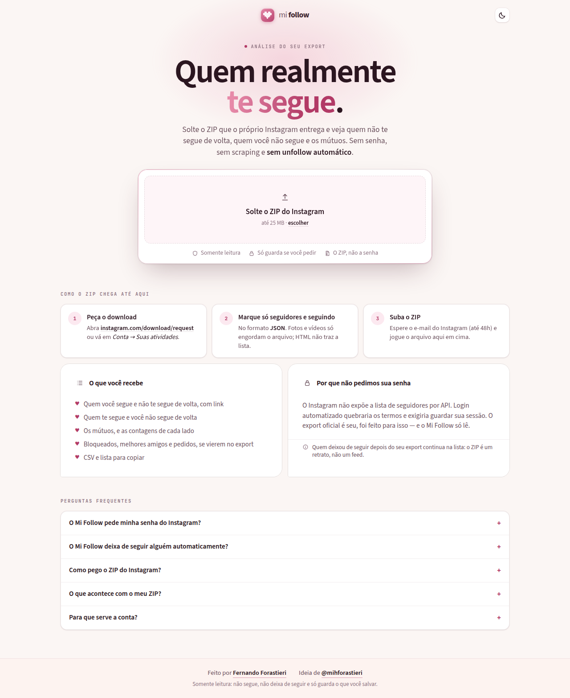
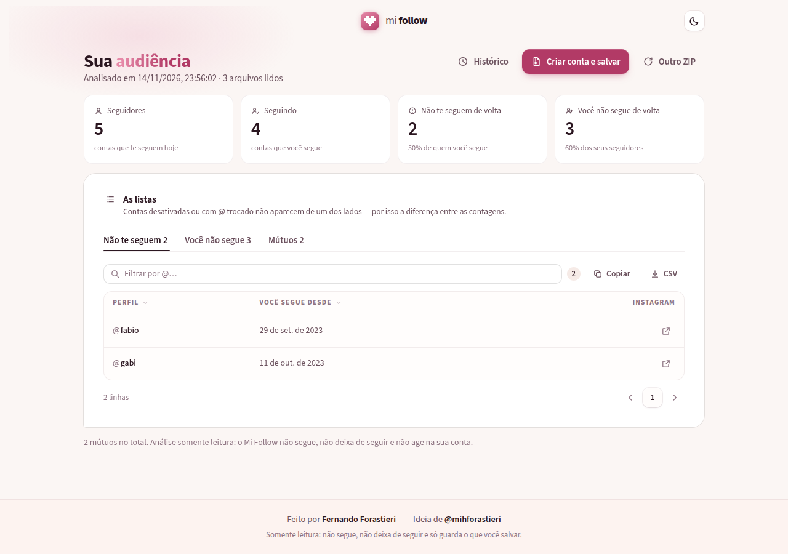

# Mi Follow

Quem realmente te segue no Instagram. Você sobe o ZIP do **export oficial** e
recebe: quem você segue e não te segue de volta, quem te segue e você não segue,
os mútuos, as contagens — cada perfil com link. Somente leitura: o site não segue,
não deixa de seguir e não pede sua senha do Instagram.

**[mifollow.fer.tec.br](https://mifollow.fer.tec.br)**



## Por que o ZIP, e não login

O Instagram não expõe a lista de seguidores por API (a Graph API dá contagem e
insights de contas Business/Creator, nunca a lista nominal; a Basic Display API foi
descontinuada). Login automatizado quebraria os termos e exigiria guardar sessão de
usuário. O caminho é o export que o próprio Instagram entrega:

1. `instagram.com/download/request` (ou _Conta → Suas atividades → Baixar suas informações_)
2. marcar só **Seguidores e seguindo**
3. formato **JSON** (HTML não traz a lista)
4. subir o ZIP no site

## O que a análise entrega

- quem você segue e **não te segue de volta**, com link para cada perfil
- quem te segue e **você não segue**
- os **mútuos**, e a proporção de cada lado
- bloqueados, melhores amigos, pedidos pendentes e “deixaram de te seguir”, quando vêm no export
- busca, paginação, copiar a lista e exportar CSV



## Contas e comparação de períodos

Depois da primeira análise, **Salvar análise** cria uma conta — e-mail e senha, sem
Instagram e sem confirmação por e-mail. Com conta, o histórico compara duas datas:

- quem **passou a te seguir** e quem **deixou de te seguir**
- quem **você passou a seguir** e quem **você deixou de seguir**
- a variação de seguidores e seguindo

O banco guarda só a análise que você mandar salvar: `@`, link e data de cada
perfil, nunca o ZIP. Limite de 24 análises por conta; **Apagar conta** remove tudo
na hora.

## Stack

| Camada | Escolha |
| --- | --- |
| UI | React 19 + [faang-ui](https://www.npmjs.com/package/faang-ui) |
| Build | Vite (site estático em `dist/`) |
| Backend | um Worker: análise, contas e assets estáticos |
| Dados | Cloudflare D1 (só o que a pessoa manda salvar) |
| Deploy | `wrangler deploy` (Workers, sem Pages) |

Publicado em **https://mifollow.fer.tec.br**, com `workers_dev: false` — o Worker
não responde em `<worker>.workers.dev`, só no domínio próprio.

## Segurança

| Peça | Como |
| --- | --- |
| Senha | PBKDF2-SHA256, 100 mil iterações (teto do Workers), sal por conta |
| Sessão | token opaco de 32 bytes; o banco guarda só o SHA-256 |
| Cookie | `__Host-mf_session` em https: `HttpOnly`, `Secure`, `SameSite=Lax`, `Path=/`, sem `Domain` |
| CSRF | `Origin` conferido em todo `POST`/`DELETE` |
| Força bruta | 12 tentativas de senha por minuto por IP; 120 requisições de `/api/` por minuto por IP |
| Cabeçalhos | CSP fechada (`script-src 'self'`), HSTS, `X-Frame-Options: DENY`, `nosniff`, `Referrer-Policy`, `Permissions-Policy` |
| Isolamento | toda consulta de análise filtra por `user_id` |
| Descarte | o ZIP é lido em memória e morre com a requisição; nada dele é gravado |

Os limites por IP usam o binding de Rate Limiting do Workers: são aproximados e
contados **por localização** da Cloudflare, como a própria documentação descreve.

## SEO

A página é uma SPA, mas tudo que importa para buscador e compartilhamento está no
HTML servido:

- `<title>`, `meta description`, `canonical` e `robots` (index, follow, imagem grande)
- Open Graph e Twitter Card completos, com **`og.png` 1200×630** gerado da identidade
- **JSON-LD**: `WebSite`, `WebApplication` e `FAQPage`
- FAQ real na página, em `<details>` — as respostas existem sem JavaScript e batem
  com o `FAQPage`
- `sitemap.xml`, `robots.txt` e `<noscript>` com o resumo do produto, `<h1>` único e
  seções com `h2`
- PWA instalável, `theme-color` por tema e `lang="pt-BR"`

## PWA

`manifest.webmanifest` (ícones 192/512 + maskable), service worker e apple-touch.
O service worker guarda o **shell** e nunca intercepta `/api/`: análise, login e
histórico sempre vêm da rede. Offline, a última tela continua aberta.

## Rodando

```bash
npm install
npm run dev        # site em http://localhost:5173 (proxy de /api para :8787)
npm run dev:api    # Worker em http://127.0.0.1:8787, para o proxy acima
```

Para ver o site servido pelo próprio Worker (o que vai para produção):

```bash
npm run preview    # build + wrangler dev em http://127.0.0.1:8787
```

## Deploy pelo Workers Builds

Cada push na `main` pode buildar e publicar direto do GitHub. No painel:

1. **Workers & Pages → Create application → Workers → Import a repository** e escolha
   `ferforastieri/mi-follow`.
2. Preencha:

   | Campo | Valor |
   | --- | --- |
   | Root directory | `/` |
   | Build command | `npm ci && npm run build` |
   | Deploy command | `npx wrangler deploy` |
   | Build variable | `NODE_VERSION=22` |

3. Salve. O `wrangler.jsonc` já leva as bindings (D1, assets, rate limits) e o
   domínio próprio — não há nada para configurar no painel.

O banco precisa existir uma vez, com o schema aplicado:

```bash
npx wrangler d1 create mi-follow      # confira o database_id no wrangler.jsonc
npx wrangler d1 execute mi-follow --remote --file db/schema.sql
```

Para publicar da sua máquina, `npm run deploy` faz o mesmo caminho.

## Contrato da API

`POST /api/analyze` com o ZIP cru no corpo e `Content-Type: application/zip`.

- `200` — `Report` (veja `shared/types.ts`)
- `413` — acima de 25 MB
- `415` — não é ZIP
- `422` — ZIP válido, mas sem os arquivos esperados (com `hint` explicando)
- `429` — limites por IP (20 análises/min; 120 requisições/min no total)

Conta e histórico (cookie de sessão; `401` sem ele):

| Rota | O que faz |
| --- | --- |
| `POST /api/auth/register` | `{ email, password }` → cria conta e sessão |
| `POST /api/auth/login` | `{ email, password }` → sessão |
| `POST /api/auth/logout` | encerra a sessão |
| `GET /api/auth/me` | `{ user }` ou `{ user: null }` |
| `DELETE /api/auth/account` | apaga conta, sessões e análises |
| `GET /api/snapshots` | lista as análises salvas (sem as listas) |
| `POST /api/snapshots` | `{ report }` → guarda uma análise |
| `DELETE /api/snapshots/:id` | apaga uma análise |
| `GET /api/snapshots/compare?from=&to=` | diferença entre duas análises |

## Arquivos que o parser entende

Por nome de base, em qualquer pasta do ZIP:

| Arquivo | Uso |
| --- | --- |
| `followers.json`, `followers_1.json`, `followers_2.json`… | seguidores (somados) |
| `following.json` | quem você segue |
| `pending_follow_requests.json` | pedidos enviados |
| `blocked.json` / `blocked_profiles.json` | bloqueados |
| `close_friends.json` | melhores amigos |
| `recently_unfollowed_profiles.json` | deixaram de te seguir |

Exports novos mudam nomes de tempos em tempos; o parser aceita tanto o formato de
array quanto o objeto com `relationships_*`.

## Banco

Schema em `db/schema.sql`: `users`, `sessions` e `snapshots`. Toda análise é lida
pelo `user_id` da sessão.

## Limites conhecidos

- Conta desativada ou @ trocado não aparece de um dos lados — por isso as listas
  podem não fechar com as contagens.
- O export é um retrato: quem deixou de seguir depois do download continua na lista.
- O Instagram leva até 48h para liberar o download.
- Não há recuperação de senha: sem envio de e-mail, um reset seguro não existe.
- A conta guarda dados de terceiros (os `@` das suas listas) enquanto você quiser:
  apague a análise ou a conta quando não precisar mais.

## Créditos

Feito por [Fernando Forastieri](https://github.com/ferforastieri). Ideia de
[@mihforastieri](https://www.instagram.com/mihforastieri/).
